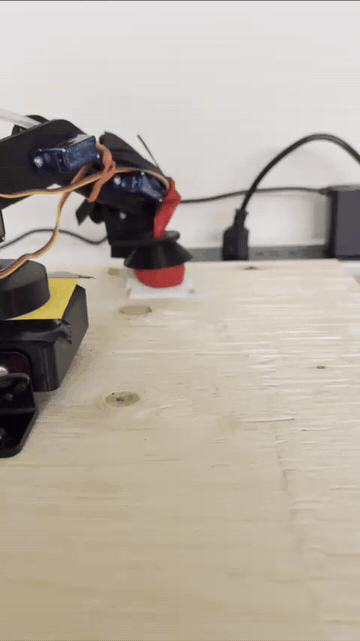
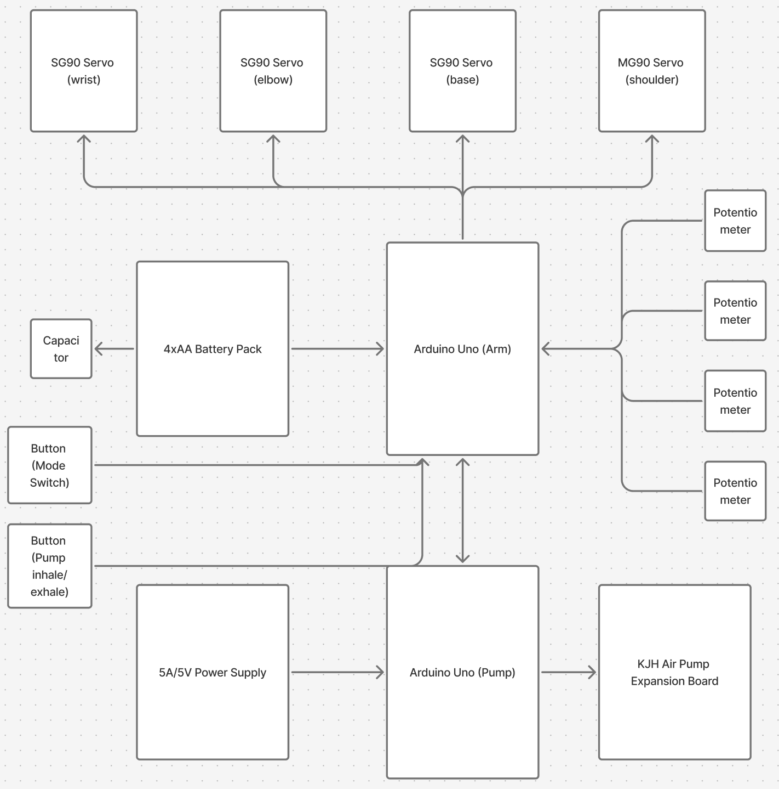
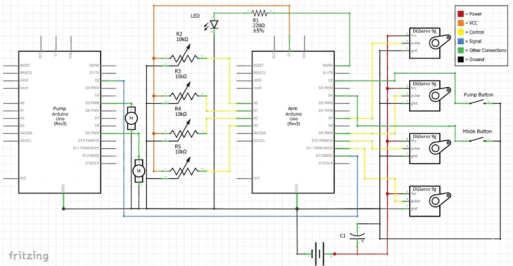
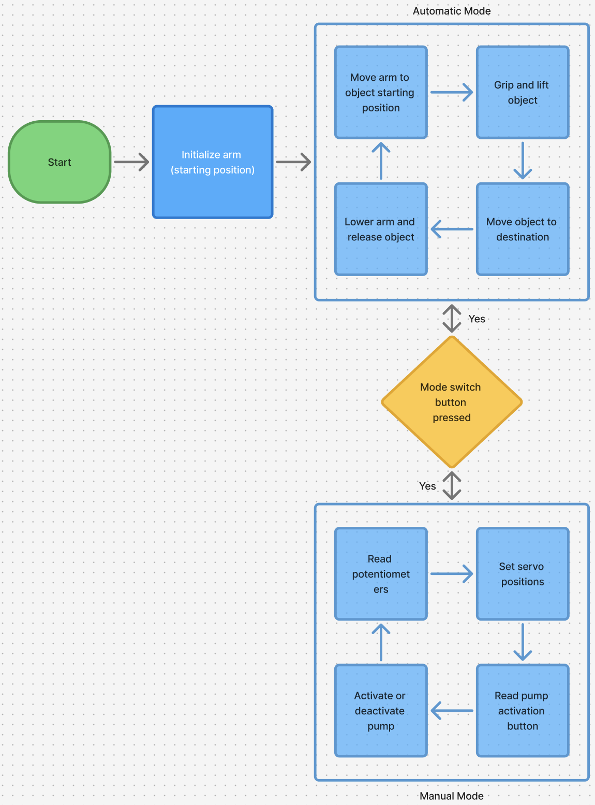
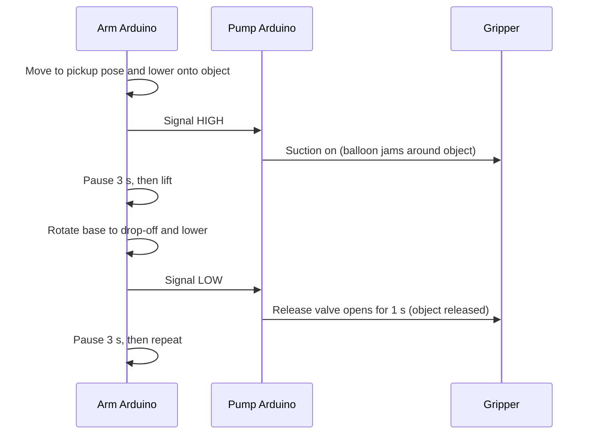

# Pick-and-Place Three-Axis Robotic Arm

A low-cost, 3D-printed robotic arm with a **suction-based jamming gripper**, controlled by two Arduino Uno boards. The arm runs in two modes: an **automatic** mode that repeats a hard-coded pick-and-place cycle, and a **manual** mode where each joint is driven by a potentiometer.

Built as the Winter 2026 Computer/Electrical Engineering Capstone Design Project at Toronto Metropolitan University (Department of Electrical, Computer and Biomedical Engineering).

**Team:** Rafael Capela-Rocha, Luca Valitutti, Katrina Kezele, Jacob Mohamed

<p align="center">
  
</p>
<p align="center"><em>The arm picking up an object with the jamming gripper.</em></p>

---

## Table of Contents

- [Features](#features)
- [How It Works](#how-it-works)
- [Hardware](#hardware)
- [Wiring and Pin Map](#wiring-and-pin-map)
- [Getting Started](#getting-started)
- [Usage](#usage)
- [Mechanical Design](#mechanical-design)
- [Kinematics](#kinematics)
- [Test Results and Lessons Learned](#test-results-and-lessons-learned)
- [Bill of Materials](#bill-of-materials)
- [Future Work](#future-work)
- [Repository Structure](#repository-structure)
- [References](#references)
- [License](#license)

---

## Features

- **Four servo-driven joints:** base rotation, shoulder, elbow, and wrist
- **Automatic mode:** repeats a three-phase pick, lift, and place sequence using positions found through testing
- **Manual mode:** four potentiometers control the joints in real time, and a button toggles suction
- **Position recording:** a long press of the mode button in manual mode saves the current pose as a custom phase (up to 8)
- **Universal jamming gripper:** a latex balloon filled with instant coffee grounds conforms to an object under vacuum and releases when air is restored
- **Dual-Arduino architecture:** one board handles motion and the other handles the pumps, linked by a single signal wire
- **Smooth, sequenced motion:** servos step one degree at a time in a non-blocking state machine
- **Low cost:** the total build cost was $145.58, under half of the $300 budget

## How It Works

### System overview

Two Arduinos split the work. The **Arm Arduino** reads the potentiometers and buttons and moves the servos. The **Pump Arduino** only turns suction on and off, driven by a signal from the Arm Arduino. The servos run from the 4×AA battery pack (with a smoothing capacitor), and the pump board runs from a separate 5 V / 5 A supply.

<p align="center">
  
</p>
<p align="center"><em>Block diagram of the robotic arm and its components.</em></p>

### Wiring schematic

The full circuit, drawn in Fritzing, shows how the potentiometers, buttons, LED, servos, capacitor and both Arduinos connect. The blue wire between the boards is the single signal line from the Arm Arduino to the Pump Arduino.

<p align="center">
  
</p>
<p align="center"><em>Fritzing schematic of the full robotic arm assembly.</em></p>

> **Note:** some pin positions in this drawing differ from the firmware. When wiring your build, follow the [pin map](#wiring-and-pin-map) below, which matches the code.

### Mode logic

The mode button switches between the two modes. Each switch first stops the pump and returns the arm to its default pose, so every mode starts from a known position.

<p align="center">
  
</p>
<p align="center"><em>Operation flow chart for automatic and manual modes.</em></p>

### One pick-and-place cycle

This shows what happens in automatic mode during one full cycle:



### Motion control

- The arm moves **one servo at a time**, one degree every 20 ms, in the order base, wrist, elbow, shoulder. This keeps current draw low and avoids brown-outs on the shared supply.
- Motion is non-blocking, so the arm can still react to button presses while moving.
- When returning to default, the **shoulder moves first**, then base, elbow, and wrist.

## Hardware

| Component | Qty | Role |
|---|---|---|
| Arduino Uno R3 | 2 | "Arm" controller and "Pump" controller |
| SG90 micro servo (plastic gear) | 3 | Base, elbow, wrist |
| MG90S micro servo (metal gear) | 1 | Shoulder, which carries the full arm load |
| KJH dual air-pump expansion board (2 pumps and a 3-way solenoid valve) | 1 | Vacuum and release for the gripper |
| 10 kΩ potentiometer | 4 | Manual joint control |
| Push button | 2 | Mode switch and pump toggle |
| LED and 220 Ω resistor | 1 | Manual-mode indicator |
| 1000 µF capacitor | 1 | Servo supply smoothing |
| 4×AA NiMH pack (4.8–5.6 V) | 1 | Servo power |
| 5 V / 5 A supply | 1 | Pump board power |
| Latex balloon, instant coffee, microfiber cloth, silicone tubing | - | Jamming gripper |

Pump specs: 4.5–8.4 V rated, up to −58 kPa vacuum, 3.0 L/min airflow.

## Wiring and Pin Map

### Arm Arduino

| Function | Pin |
|---|---|
| Base servo | `D6` |
| Wrist servo | `D11` |
| Elbow servo | `D10` |
| Shoulder servo | `D9` |
| Pots (base / wrist / elbow / shoulder) | `A0` / `A1` / `A2` / `A3` |
| Mode button (`INPUT_PULLUP`) | `D2` |
| Pump button (`INPUT_PULLUP`) | `D3` |
| Mode LED | `D4` (via 220 Ω) |
| Pump signal out | `D12` |

### Pump Arduino

| Function | Pin |
|---|---|
| Signal in (from Arm `D12`) | `D2` |
| Suction (inhale) | `D4` |
| Release (exhale) | `D3` |

### Notes

- Connect **Arm `D12` to Pump `D2`**. HIGH means inhale and LOW means exhale.
- All grounds must be shared: servo battery pack, both Arduinos, and the pump supply.
- Power the servos from the 4×AA pack, **not** from the Arduino's 5 V pin. Place the 1000 µF capacitor across the servo supply and ground.
- Use **four NiMH cells**. Three alkaline AAs (4.5 V) did not give the servos enough torque under load.

## Getting Started

### Prerequisites

- [Arduino IDE](https://www.arduino.cc/en/software) (or `arduino-cli`)
- The built-in `Servo` and `SoftwareSerial` libraries (included with the IDE)

### Upload the firmware

1. Open the sketch in `robotic_arm_code/` and upload it to the **Arm** Arduino.
2. Open the sketch in `pump_code/` and upload it to the **Pump** Arduino.
3. Wire the boards as described above and power both systems.

### Calibrating positions

The three hard-coded poses are in the arm sketch. Each is `{ base, wrist, elbow, shoulder }` in degrees:

```cpp
int defaultPositions[NUM_SERVOS] = {90, 0, 0, 0};
int autoPhase1[NUM_SERVOS] = { 140, 55, 32, 74};  // pickup
int autoPhase2[NUM_SERVOS] = { 141, 55, 32, 16};  // lift up
int autoPhase3[NUM_SERVOS] = { 36, 55, 32, 16};   // rotate and put object down
unsigned long phasePauseMS[] = {3000, 0, 3000};   // pause after each phase (ms)
```

These values depend on your build and object placement. You can find them with manual mode and the serial monitor (9600 baud): move the arm with the pots and **long-press** the mode button to print and record each pose. Copy the printed angles into the arrays above.

Setting `CALIBRATION_MODE = true` attaches the servos at a fixed angle for horn alignment during assembly.

## Usage

| Action | Result |
|---|---|
| Power on | Arm homes and starts automatic mode |
| Short press, mode button | Return to default, then switch between automatic and manual |
| Pump button (manual mode) | Toggle suction on and off |
| Long press (1 s or more), mode button (manual mode) | Record current pose as a custom phase |
| LED on / off | Manual / automatic |

When recorded phases exist, the automatic sequence runs those instead of the hard-coded ones.

## Mechanical Design

All structural parts were designed in CAD and 3D printed. A single servo-mount footprint based on the SG90 datasheet is reused for every joint, so parts are interchangeable. Longer parts were split to avoid overhangs and reduce support material.

| Part | Notes |
|---|---|
| Base | 7 × 7 × 2.5 in housing |
| Rotational base | 3 in diameter disc with the shoulder servo mount |
| Arm segments | 8 in links with servo cavities |
| Upper segment and wrist | Mounts the final servo and the gripper |
| Gripper mount | Conical mount, 4.77 in outer diameter, holding the balloon and filter |

### Jamming gripper

- A thick latex balloon (thinner balloons risk rupture) is filled with a **mix of hand-ground and whole instant coffee**. Whole granules stay flexible and fine particles improve grip.
- Pure fine ground coffee packed too densely, and pure instant coffee broke down over repeated cycles.
- A **microfiber cloth filter**, held on with a zip tie, covers the tubing end inside the balloon to keep grounds out of the pump.
- Silicone tubing runs through the arm from the pump board to the gripper.

## Kinematics

The project report documents the forward and inverse kinematics for the planar arm (L₁, L₂ are link lengths; θ₁ is the angle in the x–y plane, θ₂ and θ₃ are the vertical joint angles):

```
x = [L1·cos(θ2) + L2·cos(θ2 + θ3)] · cos(θ1)
y = [L1·cos(θ2) + L2·cos(θ2 + θ3)] · sin(θ1)
z =  L1·sin(θ2) + L2·sin(θ2 + θ3)
```

The base servo only rotates the whole assembly, so it has no separate kinematic equation. The current firmware uses **hard-coded joint-angle poses** rather than computing inverse kinematics at runtime. See the report for the full inverse-kinematics derivation.

## Test Results and Lessons Learned

| Problem | Cause | Fix |
|---|---|---|
| Incomplete or unstable motion under load | 3 × 1.5 V AA (4.5 V) could not supply peak servo current | Switched to 4 × 1.2 V NiMH (4.8 V) |
| Shoulder could not lift the arm; audible gear clicking | SG90 plastic gears were overloaded | Replaced with a metal-gear MG90S |
| Shoulder jitter during lifts | Voltage dips from servo current spikes | Added a 1000 µF capacitor on the servo supply |
| Balloon rupture risk | Thin latex under repeated vacuum | Thicker balloon, with some loss of dexterity |
| Grounds entering the pump | No filter | Microfiber cloth filter at the tubing inlet |
| Pump overheating | Continuous suction | Not observed: ~50 consecutive cycles showed only mild warmth |

Overall, the final system performs repeatable pick-and-place with improved stability. Minor limitations remain in motion smoothness and grip consistency across all object types.

## Bill of Materials

| Item | Qty | Cost ($) |
|---|---|---|
| Air pump / tubing / valve | 1 | 52.49 |
| Arduino Uno | 2 | 11.30 |
| Balloons | 1 | 1.70 |
| Batteries, AA (NiMH) | 4 | 27.92 |
| Battery holder | 1 | 3.64 |
| Buttons | 2 | 1.63 |
| Capacitor (1 mF) | 2 | 2.26 |
| Coffee grounds | 1 | 1.41 |
| Microfiber cloth | 1 | 1.62 |
| NiMH battery charger | 1 | 13.40 |
| Potentiometer | 4 | 2.28 |
| Power supply | 1 | 20.00 |
| Servo, MG90 | 1 | 1.62 |
| Servo, SG90 | 3 | 4.31 |
| **Total** | **23** | **145.58** |

## Future Work

- Add sensors for closed-loop position control, reducing reliance on pre-programmed poses
- Use all MG90S metal-gear servos (about $1–2 more per servo) for strength and durability
- Simplify the architecture, either by reducing the number of microcontrollers or by upgrading the inter-board link beyond a single signal wire
- Tune the gripper fill and pressure control for a wider range of objects
- Use the documented inverse kinematics to command the arm by x/y/z coordinates

## Repository Structure

```
.
├── README.md
├── LICENSE
├── robotic_arm_code/     # Arm Arduino firmware (motion, modes, buttons)
├── pump_code/            # Pump Arduino firmware (suction and release)
└── docs/
    ├── 3_Axis_Robotic_Arm_Capstone_Report.pdf
    ├── demo.gif
    ├── fritzing-schematic.png
    ├── mode-logic.png
    └── system-overview.png
```

## References

1. E. Brown, N. Rodenberg, J. Amend, et al., "Universal robotic gripper based on the jamming of granular material," *Proc. Natl. Acad. Sci.*, vol. 107, no. 40, pp. 18809–18814, Oct. 2010.

## Acknowledgements

Thanks to our Faculty Lab Coordinator, Meranda Salem, and our course coordinator, Dr. Naimul Mefraz Khan, for their guidance and support throughout the project.

## License

This project is licensed under the [MIT License](LICENSE).
# 3-Axis-Robotic-Arm
